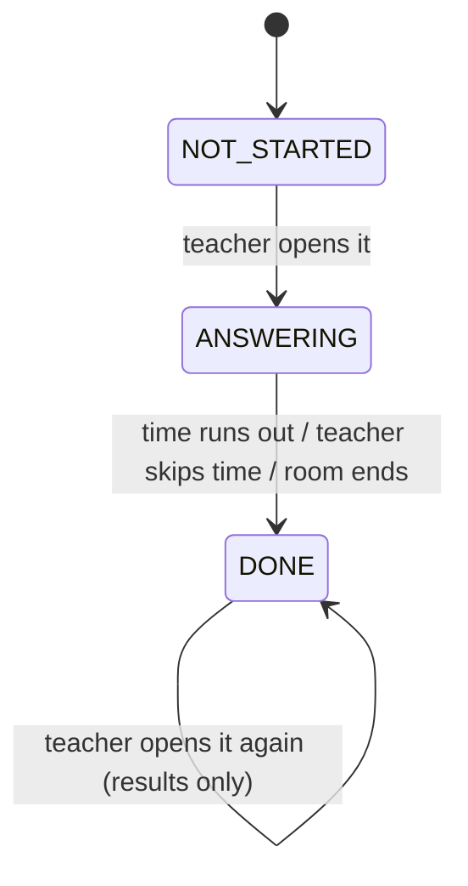

# Contract

This is what the backend, the teacher web and the student app must agree on.
If you change anything here, tell the other two teams.

## Terms

Use these exact words in code, API, Firebase, Trello and chat. Don't invent synonyms (no "bell alert", "stats", "reveal", "round").

| Term | Meaning | In code |
| --- | --- | --- |
| Rung Chuông Vàng | The feature. Say this to people. | Mode value `golden_bell`. Prefix `GoldenBell` for classes and files, `GOLDEN_BELL` for constants, in all 3 repos. |
| Normal mode | Today's exam, where each student does the whole test alone | Mode value `auto_advance` |
| Room | One exam room, as today | `roomId` (the existing exam room id) |
| Game | One Rung Chuông Vàng run in a room, from Start to End | (no code name, use Room) |
| Live state | The live question plus every question's status | `GET .../live`, `LiveState` |
| Question | One question of the room's assignment | `index`, starting at 0. On screen show "Câu {index + 1}". |
| Question status | Where a question is | `NOT_STARTED`, `ANSWERING`, `DONE` |
| Live question | The question everyone sees now | Firebase `liveQuestion` |
| Open | Teacher shows a question (starts it if `NOT_STARTED`) | `OpenQuestion` (BE), `openQuestion` (web) |
| Close | End a question now or when time runs out | `CloseQuestion` (BE), `closeQuestion` (web) |
| Submit | Student presses Nộp bài and sends the answer | `SubmitAnswer` (BE), `submitAnswer` (Unity) |
| Answered | A student has submitted for this question | Firebase `liveAnswers` |
| Results | Right/wrong counts and per-student result for a `DONE` question | `GET .../results`, `QuestionResults` |
| Result | One student's result on one question | `CORRECT`, `WRONG`, `NO_ANSWER`. On screen: Đúng / Sai. |
| Time limit | Seconds a question stays `ANSWERING` | `timeLimitSec` |
| Deadline | When the question closes | `deadlineAt` (server time, epoch ms) |
| Room duration | Total time for the whole room (15 to 90 min) | `durationMinutes` (existing) |
| Host screen | The teacher's screen for running the game | `GoldenBellHost` (web) |
| Student | A student in the room | `studentId` (the same id the existing participant list uses) |

## Question status

Each question in a room has one status:

| Status | Meaning |
| --- | --- |
| `NOT_STARTED` | Nobody has seen it yet |
| `ANSWERING` | It's on screen and the countdown is running |
| `DONE` | Time is up or the teacher skipped the time; results are ready |



Only one question can be `ANSWERING` at a time. While it is, the teacher can't open another one.

## Firebase

Only the backend writes. The apps only read.

### `exam-rooms/{roomId}/state` (everyone listens, already exists)

We add one field, `liveQuestion`:

```json
{
  "state": "IN_PROGRESS",
  "startedAt": 1705315200000,
  "durationMinutes": 45,
  "timestamp": 1705315230000,
  "liveQuestion": {
    "index": 3,
    "status": "ANSWERING",
    "startedAt": 1705315230000,
    "deadlineAt": 1705315260000,
    "timeLimitSec": 30,
    "version": 7
  }
}
```

- `index` starts at 0.
- `liveQuestion` is missing until the teacher opens the first question.
- Count down using `deadlineAt` and the server clock (both apps already sync with the server clock). Never use the device clock alone.
- `version` goes up on every change. Ignore an update with a lower version than the one you have.

### `exam-rooms/{roomId}/liveAnswers/{index}/{studentId}` (teacher web only)

```json
{ "answeredAt": 1705315241000 }
```

One entry per student who pressed Nộp bài for that question. The teacher web uses it for the answered / not answered list. It does not say right or wrong.

## API

All routes sit next to the existing exam-room routes (same prefix and same login token).
Teacher calls that change the game send `expectedVersion`. If someone else changed the game first (a second tab or a double click), the backend answers `409 VERSION_CONFLICT`. Then reload with `GET /live`.

### Teacher

| Call | What it does |
| --- | --- |
| `GET /exam-rooms/{id}/live` | Current `liveQuestion`, the status of every question, and the server time. Use it on page load and reconnect. |
| `POST /exam-rooms/{id}/questions/{index}/open` | Body `{ expectedVersion }`. If the question is `NOT_STARTED`, starts it for everyone. If it's `DONE`, just shows it again (results only). Used by Câu trước, Câu tiếp theo and the question list. |
| `POST /exam-rooms/{id}/questions/{index}/close` | Body `{ expectedVersion }`. Ends the question now (Bỏ qua thời gian). Safe to call twice. |
| `GET /exam-rooms/{id}/questions/{index}/results` | Right / wrong counts and the list of students with their result. Only for `DONE` questions. |

`open` errors: `409 QUESTION_RUNNING` (another question is still `ANSWERING`) and `409 VERSION_CONFLICT`.

Results response:

```json
{
  "index": 3,
  "total": 30,
  "correct": 21,
  "wrong": 9,
  "students": [
    { "studentId": "s1", "name": "Nguyễn Văn Nam", "result": "CORRECT" },
    { "studentId": "s2", "name": "Lê Hồng Hạnh", "result": "WRONG" },
    { "studentId": "s3", "name": "Trần Minh", "result": "NO_ANSWER" }
  ]
}
```

`wrong` includes students who didn't answer (`NO_ANSWER`). `total` is everyone in the room.

### Student

| Call | What it does |
| --- | --- |
| `GET /exam-rooms/{id}/live` | Same as the teacher's, without other students' data. Use it on reconnect. |
| `POST /exam-rooms/{id}/questions/{index}/answer` | Sends the student's answer when they press Nộp bài. |

Answer request:

```json
{ "answer": { }, "isCorrect": true, "score": 1 }
```

- `answer` is the same answer data the app saves today for one question.
- The app checks the answer itself (like today) and sends `isCorrect`.

Answer errors:

| Code | When |
| --- | --- |
| `409 QUESTION_CLOSED` | The question isn't `ANSWERING`, or the time ended more than 1.5 s ago |
| `409 ALREADY_SUBMITTED` | The student already submitted this question |
| `403 NOT_IN_ROOM` | The student didn't join before the game started |

The 1.5 s grace covers an answer sent right before 0 on a slow network.

### Changes to existing calls

| Call | Change |
| --- | --- |
| `POST /join` | For a golden_bell room that has started, only students who already joined can get back in. Others get `403 GAME_STARTED`. |
| `POST /end` (and the timed end) | Ends any `ANSWERING` question first, then saves each student's total so the leaderboard works as today. |
| Create room | `mode = "golden_bell"` is now allowed. The duration stays and means "the whole room". |

## Scoring

- 1 point per right answer. No answer counts as wrong.
- Time used (for ties) = the sum of answer times across questions. Answer time = `answeredAt - question startedAt`. A question with no answer counts its full time limit.
- These fill the existing participant `Score`, `TotalScore` and `CompleteTime`, so the leaderboard needs no change.

## Settings (backend config)

| Name | Default | Meaning |
| --- | --- | --- |
| `GoldenBell:QuestionTimeLimitSec` | 30 | Seconds per question until the PO decides otherwise |
| `GoldenBell:MaxStudentsPerRoom` | 1000 | Join is refused above this |
| `GoldenBell:AnswerGraceMs` | 1500 | Late answers accepted after the deadline |
