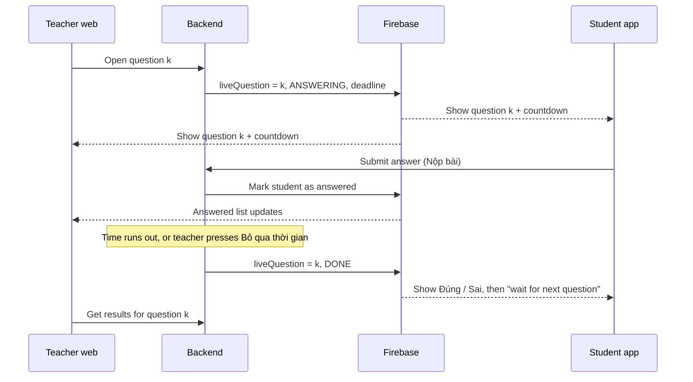

# Rung Chuông Vàng: start here

Rung Chuông Vàng is a new way to run an exam room (`mode = "golden_bell"`).
In the normal mode (`auto_advance`), every student works through the whole test alone.
In Rung Chuông Vàng, **the teacher runs the game one question at a time**, and all students answer the same question together.

## Pages

| Page | For | What's in it |
| --- | --- | --- |
| [Contract](contract.md) | Everyone | The API, the Firebase data and the rules all three apps must agree on |
| [Backend](backend.md) | BE team | What to build in `pcnl-svc-exam-net` |
| [Teacher web](web.md) | Web team | What to build in `WebGV-CST` |
| [Student app](unity.md) | Unity team | What to build in `ConSangTao` |

**Tickets:** the **What to build** section of each team page is that team's ticket list (3 or 4 big tickets), in order. One dev per team works top to bottom. One ticket = one Trello card = one PR. Progress is tracked in Trello, not here.

**Names:** the feature is "Rung Chuông Vàng" for people and `golden_bell` / `GoldenBell` / `GOLDEN_BELL` in code, in all 3 repos. The old name `bell_alert` is gone; don't use it. Every other name we use (question status, open, close, submit, results…) is in [Terms](contract.md#terms). Use those words everywhere, including Trello cards.

## How a game goes

1. The teacher creates a room and picks **Rung Chuông Vàng**. Same form as today, including the room duration (15 to 90 minutes).
2. Students join with the code and wait, like today.
3. The teacher presses **Start**. After that, nobody new can join.
4. The teacher opens question 1. Every student sees it at the same moment, with a countdown.
5. Students answer and press **Nộp bài**. The teacher sees who has answered.
6. The question ends when time runs out or the teacher presses **Bỏ qua thời gian**.
7. The teacher sees the results: how many got it right or wrong, and who. Each student sees **Đúng** or **Sai**.
8. The teacher goes to the next question and repeats.
9. The room ends when the teacher presses **Kết thúc phòng thi** or the room's time runs out. Then the leaderboard shows, like today.

## The main ideas

- **The backend is the boss.** It decides which question is open and when it ends. The apps only follow what Firebase tells them.
- **Firebase pushes changes.** We already use it at `exam-rooms/{id}/state`. We add one field there, `liveQuestion`, so every screen stays in sync.
- **We reuse what exists.** Room creation, joining, the waiting room, start/end, the leaderboard, the question images on the web and the question screens in Unity all stay.
- **The student app still checks the answer itself**, like today, and sends right/wrong to the backend.

## Rules (agreed with the PO)

- The teacher can only go to the next question after the current one is closed and shows its results.
- **Câu trước** / **Câu tiếp theo** go to the question just before or after. The teacher can also pick any question from the list.
- Opening a closed question shows only its results. Opening a question that hasn't been played starts it for everyone.
- Students confirm with **Nộp bài** in the existing in-game menu.
- No one can join after the game starts. Students who were already in can reconnect.
- The room ends on time or when the teacher ends it.
- Students don't see the correct answer for now, but the design should allow adding it later.
- Rooms can have 50 to 1,000 students.
- Students who don't submit count as wrong. The % bar counts everyone in the room.

## Still open (we use the default until the PO decides)

| Question | Default for now |
| --- | --- |
| How long is each question? | 30 seconds for every question, set in config |
| Can a student change an answer after Nộp bài? | No, one submit per question |
| Do students see the correct answer? | No, only Đúng / Sai |
| Is 1,000 students per room needed in the first release? | Yes; the cap is a config value |
| Does a wrong answer knock a student out? | No, everyone plays every question |
| Score and tie-break | 1 point per right answer; ties go to the shorter total answer time |
| Partial credit for multi-part questions | No, all or nothing |

If the PO changes one of these, update this table and the [Contract](contract.md).

## Keeping these docs right

- Only write what the code can't tell you: the flow, the contract and the decisions. For the rest, point to the code.
- If you (or your AI) change an endpoint, a payload or a Firebase field, update [contract.md](contract.md) in the same session.
- When the project is done, add "Finished" at the top of this page and stop updating.

Add this line to each repo's AI instructions (`CLAUDE.md`, `.github/copilot-instructions.md` or similar):

> For Rung Chuông Vàng (golden_bell) work, read `../cst-plans/docs/index.md`, `contract.md` and this repo's page first. If you change an endpoint, payload or Firebase field, update `contract.md` in the same session.
