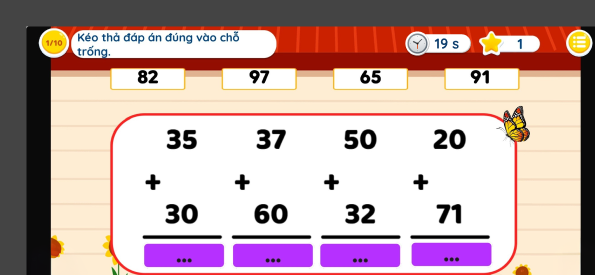
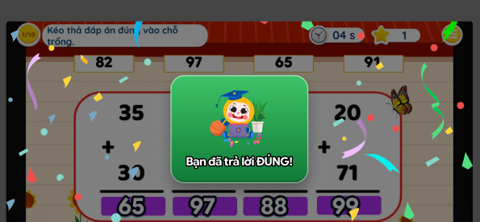
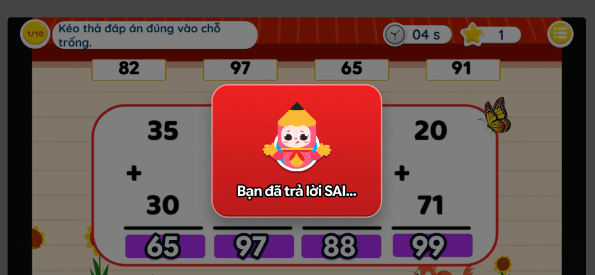
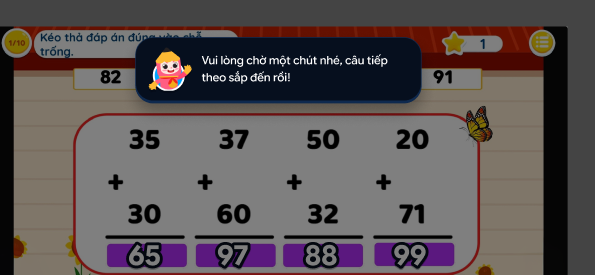

# Student app (ConSangTao)

Read the [Contract](contract.md) first, and use the names from [Terms](contract.md#terms). Designs: Figma "Trao đổi tech", Rung Chuông Vàng section (student frames).

## In short

The student doesn't move between questions anymore. **The app shows whatever question the teacher has opened**, and the student answers it before the time runs out.
We keep the existing question screen and add a new controller that follows the teacher.

## What to build

Each ticket below is one Trello card and one PR. Do them **top to bottom**. If a ticket needs a part from another team that isn't ready yet, fake it with the [Contract](contract.md): mock the API response, or type `liveQuestion` into Firebase by hand.

### U-1 · Follow the teacher (about 6 days)

Needs: nothing (type `liveQuestion` into Firebase by hand to test).

- Add a `golden_bell` constant and search the project for any old `bell_alert`. In `ExamLobbyController`, for `golden_bell` rooms, open the question scene with the new `GoldenBellQuestionSceneController` (based on `ExamQuestionSceneController`). `auto_advance` stays as it is.
- Read `liveQuestion` from `exam-rooms/{id}/state`. When `status` is `ANSWERING`, go to that question with `EnterQuestionByIndex(index)`.
- Hide the student's own question navigation and the whole-exam timer.
- Countdown: seconds left until `deadlineAt`, using `ExamRoomTimingSync` (server clock). At 0, lock the answer.
- Skip the screenshot upload when leaving a question, and the final reload of every question. Otherwise the app falls behind the teacher.

Done when: several phones jump to each question the teacher opens at the same time, with the same seconds left.

### U-2 · Submit and see Đúng / Sai (about 4.5 days)

Needs: BE-2 (mock it until it's ready).

- Use the existing in-game menu (Thoát, Tắt âm thanh, Làm lại, **Nộp bài**). On Nộp bài: check the answer like today (`CheckCorrectedAnswers`), send it with `submitAnswer` (`POST .../questions/{index}/answer`), and lock the question. One submit per question.
- When the question closes (`status` becomes `DONE`): show **Bạn đã trả lời ĐÚNG!** or **Bạn đã trả lời SAI...**. No answer counts as wrong. Don't show the correct answer for now.
- Then show **Vui lòng chờ một chút nhé, câu tiếp theo sắp đến rồi!** until the next question opens. Keep showing it when the teacher opens a question that is already `DONE`.

Done when: an answer sent at the last second is accepted, one sent after the time is up is refused politely, and the right pop-up shows after each question.

### U-3 · Reconnect, end, and test on phones (about 4.5 days)

Needs: BE-3.

- When the app comes back (network or resume), call `GET /live` and jump to the current state.
- When `state` becomes `ENDED`, show the end screen like today.
- Play full games on several phones with the backend and web devs and fix the bugs found.

Done when: turning Wi-Fi off and on mid-question puts the app back on the right question, and a full game on several phones stays in sync until the end.

## Watch out for

- **Speed.** Today, leaving a question uploads a screenshot, and the final submit reloads every question. Skip both in golden_bell, or the app will fall behind the teacher.
- **Loading a question takes about 1.5 s.** Start the countdown from `deadlineAt`, not from when loading finishes, so all students end at the same time.
- **Don't break auto_advance.** All new behaviour sits in the new controller.
