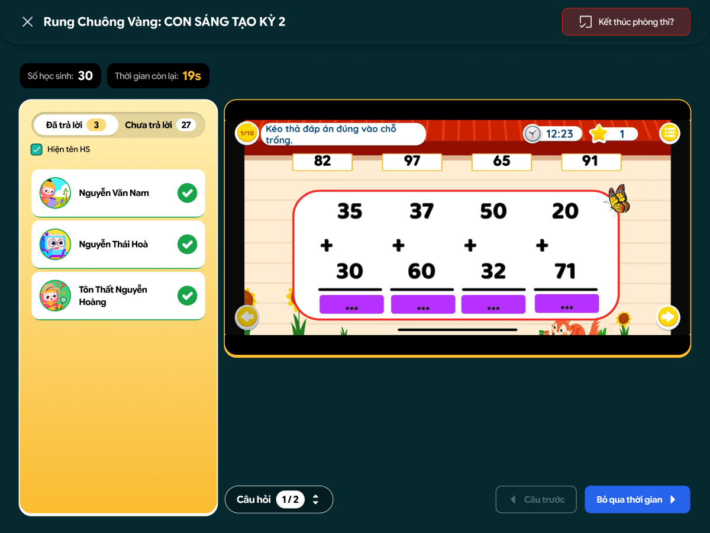
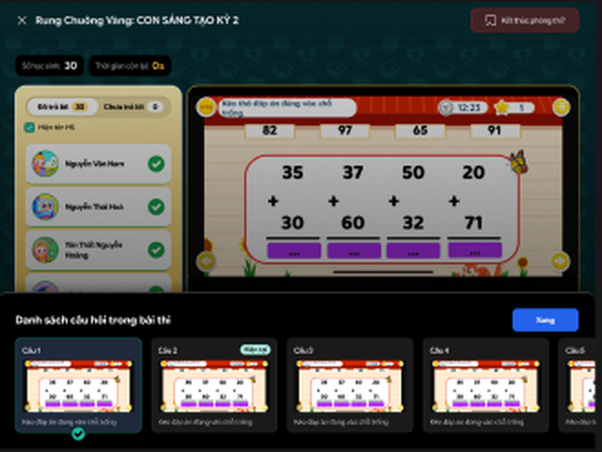
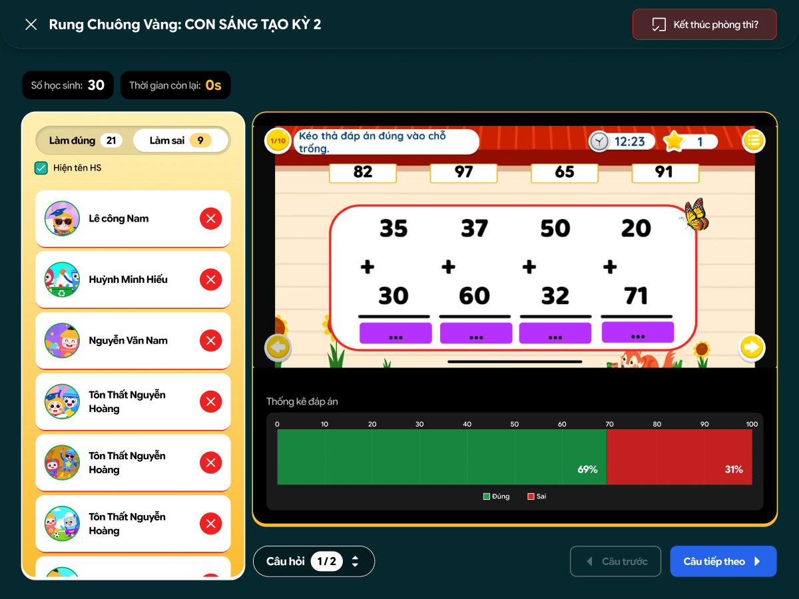
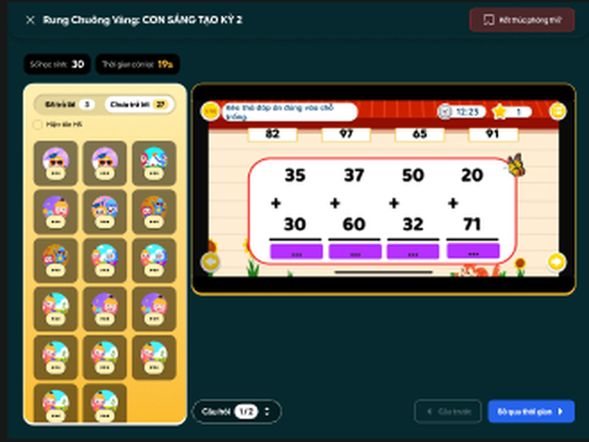
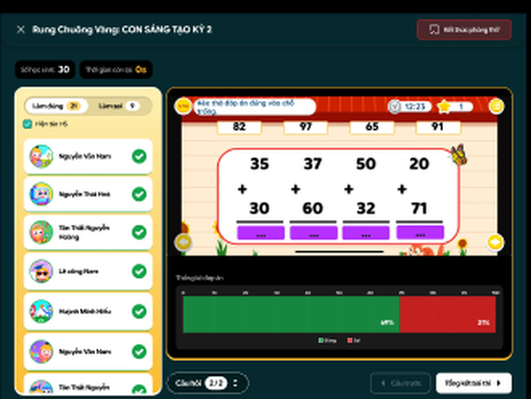
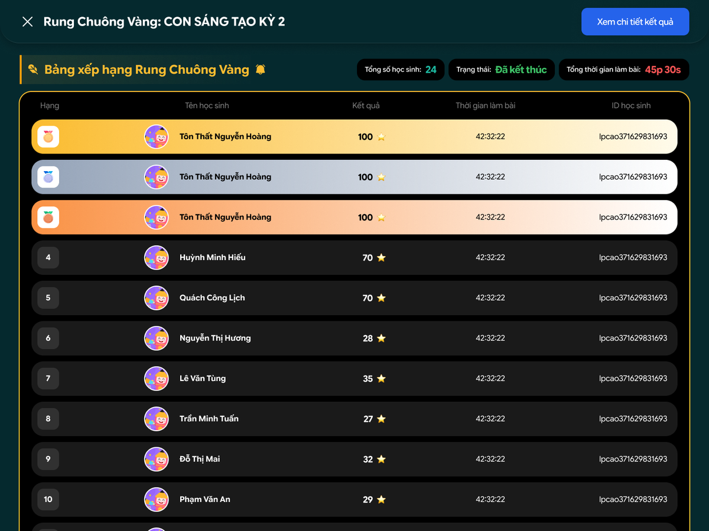

# Teacher web (WebGV-CST)

Read the [Contract](contract.md) first, and use the names from [Terms](contract.md#terms). Designs: Figma "Trao đổi tech", Rung Chuông Vàng section (teacher frames).

## In short

Add one new screen, the **host screen**, where the teacher runs the game.
Everything before (create room, waiting room) and after (leaderboard) stays as it is.

## What to build

Each ticket below is one Trello card and one PR. Do them **top to bottom**. If a ticket needs a part from another team that isn't ready yet, fake it with the [Contract](contract.md): mock the API response, or type `liveQuestion` into Firebase by hand.

### WEB-1 · Host screen that follows the game (about 6.5 days)

Needs: BE-1 (mock it until it's ready).

- In `examRooms.js`, keep `GOLDEN_BELL` but change its value from `'bell_alert'` to `'golden_bell'`. Search the repo for any other `bell_alert`. Keep the option disabled for now.
- When a golden_bell room starts, open the new host screen `GoldenBellHost` instead of `/monitor`. `auto_advance` still goes to `/monitor`.
- `useGoldenBellLive` hook, built on `useExamRoomRealtime`: read `state.liveQuestion`, call `GET /live` on load and reconnect, and use `useExamServerClock` for the countdown.
- Header: room name, **Số học sinh**, **Thời gian còn lại**, **Kết thúc phòng thi**. Reuse the existing end and leave dialogs with the Figma texts ("Thời lượng cuộc thi vẫn còn, bạn vẫn muốn kết thúc sớm?").
- Question in the middle: reuse the image from `PreviewQuestionsPopup` (`screenshot_default_link` or `CanvasImage`).
- Bottom bar: **Câu trước**, **Bỏ qua thời gian** while answering, **Câu tiếp theo** after it closes. They call `openQuestion(index)` and `closeQuestion(index)`, always with `expectedVersion`. On `409`, reload with `GET /live`. Turn off buttons that would fail.
- **Câu hỏi x/y** opens the question list. Picking a question calls `openQuestion(index)`.

Done when: the teacher can open, skip and move between questions, and reloading the page mid-question comes back to the same place.

### WEB-2 · Student panel and results (about 5 days)

Needs: BE-2 (mock it until it's ready).

- While answering: tabs **Đã trả lời / Chưa trả lời** with counts, from `liveAnswers/{index}`.
- After the question closes: tabs **Làm đúng / Làm sai** and the **Thống kê đáp án** % bar, from `GET .../results`. The % counts everyone in the room.
- **Hiện tên HS** toggle: names, or avatars only.
- Up to 1,000 students: only render the visible rows (virtual list).

Done when: the panel updates live as students submit, and the results match the backend for a game with several real phones.

### WEB-3 · Finish the game and turn the mode on (about 3 days)

Needs: BE-3, WEB-2.

- On the last question, after it closes, **Câu tiếp theo** becomes **Tổng kết bài thi** and goes to the existing leaderboard.
- Play full games with the backend and Unity devs and fix the bugs found.
- **Last step:** remove `disabled: true` from `GOLDEN_BELL` so teachers can pick the mode. The create form stays the same, including the duration.

Done when: a teacher can create a Rung Chuông Vàng room, run a full game and see the leaderboard, and `auto_advance` rooms work exactly as before.

## Watch out for

- **Up to 1,000 students.** Only render the visible part of the student list and avatar grid (virtual list).
- **Disable buttons that would fail.** For example, Câu tiếp theo stays off while the question is answering.
- **Two tabs.** The second tab just follows Firebase. Version conflicts are handled by reloading.
